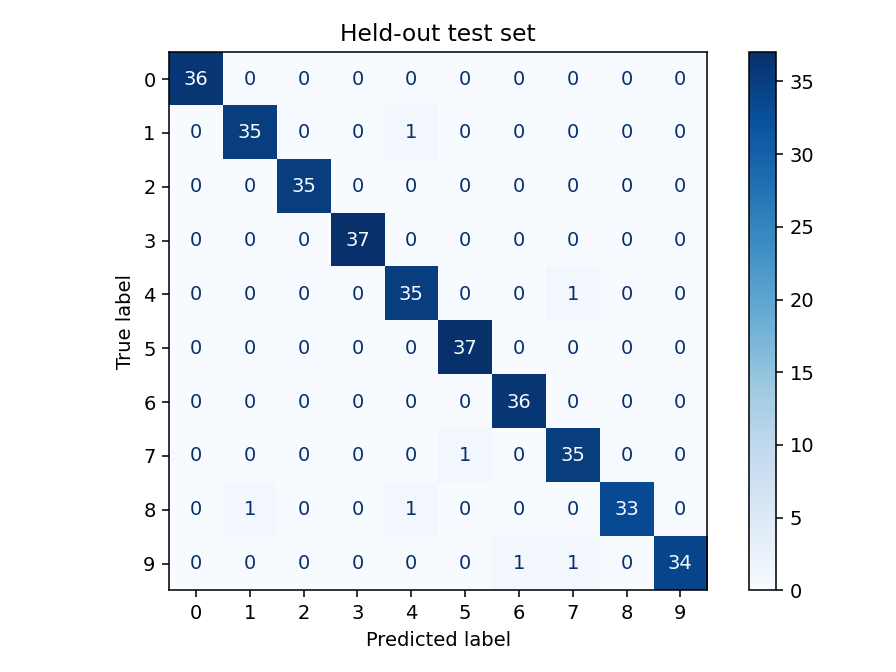
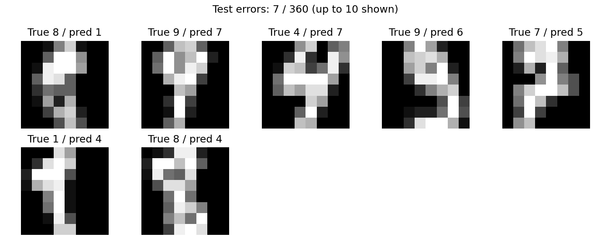

# Digit Vision — воспроизводимый baseline для распознавания цифр

Небольшой учебный проект по computer vision: сравнение логистической регрессии
и RBF SVM на изображениях рукописных цифр. Полный цикл: подготовка данных,
выбор модели по validation, финальная оценка на test, анализ ошибок и inference.
Код подготовлен с помощью AI; результаты ниже получены запуском, а не заданы вручную.

## Быстрый старт

Нужен Python 3.12. Команды выполнять из корня проекта.

```bash
python -m venv .venv
source .venv/bin/activate
# Windows PowerShell: .venv\Scripts\Activate.ps1
python -m pip install -r requirements.txt
python -m unittest discover -s tests -v
python -m digit_vision.train
python -m digit_vision.predict --image artifacts/sample.png
```

Датасет встроен в scikit-learn: отдельное скачивание данных и GPU не нужны.
Зависимости скачиваются при установке. Зафиксированы версии прямых зависимостей,
проверенные в окружении разработки; это не полный lock-файл транзитивных зависимостей.

## Эксперимент

Используется [Digits из scikit-learn](https://scikit-learn.org/stable/modules/generated/sklearn.datasets.load_digits.html):
1797 серых изображений 8×8, классы 0–9, яркости от 0 до 16.
Источник — [UCI Optical Recognition of Handwritten Digits](https://archive.ics.uci.edu/dataset/80/optical+recognition+of+handwritten+digits).
Библиотека содержит копию тестовой части исходного UCI набора; здесь она заново
разбита для учебного эксперимента. Результаты не являются официальным UCI benchmark.

1. Нормализация яркости в [0, 1], разворачивание изображения в 64 признака.
2. Стратифицированное разделение: train 1077, validation 360, test 360; seed 42.
3. Два заранее заданных кандидата: LogisticRegression(C=1) и RBF SVM(C=10).
4. StandardScaler внутри Pipeline обучается только на train при выборе модели.
5. Выбор по macro-F1 на validation. Переобучение выбранной конфигурации на train + validation.
6. Одна финальная оценка на test. Индексы разбиения сохраняются в splits.json.

Сравнение конфигураций ограничено двумя кандидатами; это не исчерпывающий поиск.
Случайное разделение не гарантирует независимости авторов почерка: writer ID здесь
не используется. Следующий более строгий эксперимент должен разделять данные по авторам.

## Результаты проверенного запуска

Выбрана **RBF SVM**. Test accuracy: **0.98056**; test macro-F1: **0.98050**.
353 правильных ответа, 7 ошибок. Полные validation/test метрики и версии окружения:
[reports/metrics.json](reports/metrics.json).





На таких маленьких изображениях форма некоторых цифр неоднозначна. Галерея показывает
все семь ошибок теста, а не только удачные примеры. Метрики описывают один split;
доверительные интервалы и устойчивость к смене seed пока не оценивались.
После просмотра test ошибок не следует подбирать параметры под этот же test.

## Своя картинка

```bash
python -m digit_vision.predict --image my_digit.png
# Для тёмной цифры на светлом фоне:
python -m digit_vision.predict --image my_digit.png --invert
```

Ожидается одна крупная, центрированная цифра. Изображение переводится в grayscale,
масштабируется с сохранением пропорций и дополняется до 8×8. Автоматического поиска
цифры, удаления фона, коррекции перспективы и калибровки уверенности нет.
Пустые и почти однотонные изображения отклоняются. Остальные входы модель всегда
относит к одной из цифр — она не умеет надёжно распознавать «не цифру».
Пример examples/digit.png взят из test: это демонстрация CLI, а не независимая
проверка на внешних данных. PNG имеет квантование до 255, в отличие от исходных
уровней 0–16; различие нормализованных яркостей проверяется тестом.

**Ограничение:** качество на фотографиях, другом почерке или смещённых цифрах может
быть существенно ниже. Это baseline на небольшом датасете, не готовая OCR-система
и не проект на deep learning. Загружайте только собственные доверенные joblib-файлы:
этот формат может исполнять код при загрузке. Веса создаются локально и не входят в Git.

## Структура

| Файл | Назначение |
|---|---|
| digit_vision/data.py | Разбиение, нормализация, чтение изображения |
| digit_vision/train.py | Сравнение, выбор, обучение, метрики и графики |
| digit_vision/predict.py | Предсказание из сохранённой модели |
| tests/test_pipeline.py | Отсутствие пересечений, preprocessing, сохранение/inference |
| reports/ | Результаты выполненного запуска |
| STUDY_GUIDE.md | Разбор кода и самостоятельные эксперименты |
| explore.py, EXPERIMENTS.md | Сравнение результатов на нескольких validation-разделениях |
| PUBLISH.md | Публикация на GitHub |

GitHub Actions содержит команды тестов и сквозного запуска. В облачном CI workflow
ещё не запускался; те же команды успешно выполнены локально.

## Что улучшить самостоятельно

- Собрать отдельный небольшой набор собственных цифр и измерить domain shift.
- Добавить метрику устойчивости к сдвигу/повороту, не настраивая модель по test.
- Сравнить с небольшой CNN на PyTorch, используя тот же протокол разделения данных.
- Добавить кросс-валидацию на train + validation, оставляя test закрытым до конца.

Первый пункт особенно полезен для обсуждения разницы между метрикой на датасете
и качеством работающего приложения.
